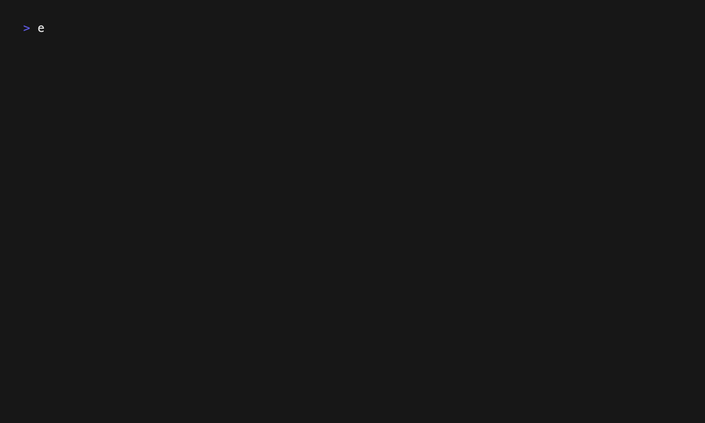

# shop

[](https://github.com/guitarkeegan/shop-cli/actions/workflows/ci.yml)
[](https://github.com/guitarkeegan/shop-cli/releases)
[](LICENSE)

A terminal tool for Shopify theme developers that scaffolds sections, theme blocks, and snippets. You describe the settings; `shop` writes the Liquid boilerplate and the `` JSON for you, either from a single command or through an interactive builder with a live preview.


## Why

Every new Shopify section starts with the same chores: assigning each setting to a variable, writing a `case` for every block type, and hand-writing a schema whose JSON must match Shopify's rules exactly. `shop` generates all of that from a short description, so you start from a file that already works in the theme editor.

## Install

**macOS and Linux:**

```bash
curl -fsSL https://raw.githubusercontent.com/guitarkeegan/shop-cli/main/install.sh | bash
```

The script downloads the latest release for your platform, verifies its checksum, and installs `shop` to `~/.local/bin`.

**With Go 1.24+:**

```bash
go install github.com/guitarkeegan/shop-cli/cmd/shop@latest
```

**Windows:** download the archive for your architecture from the [releases page](https://github.com/guitarkeegan/shop-cli/releases).

## Quick start

Run `shop` from the root of a theme, the folder that contains `sections/`, `blocks/` and `snippets/`.

**Interactive:** run `shop` with no arguments. Pick a file type, then add settings and blocks while the generated file updates beside you.

**One command:**

```bash
shop section create -n "Testimonials" \
  -b "Quote,richtext:quote:Quote,text:author:Author" \
  "text:heading:Heading"
```

```liquid


  
    

  


{
  "name": "Testimonials",
  "settings": [ ... ],
  "blocks": [ ... ],
  "presets": [{ "name": "Testimonials" }]
}

```



## Commands

| Command | Creates |
|---|---|
| `shop` | Starts the interactive builder. |
| `shop section create -n NAME [settings]` | `sections/<name>.liquid`, with blocks from repeated `-b` flags. Adds a color scheme and padding settings to every section. |
| `shop section create -t` | Pick a prebuilt feature (such as collection filters or a product carousel) and copy its Liquid, CSS and TypeScript into the theme. |
| `shop block create -n NAME [settings]` | `blocks/<name>.liquid`, a standalone theme block. |
| `shop snippet create -n NAME [params]` | `snippets/<name>.liquid` with a [LiquidDoc](https://shopify.dev/docs/storefronts/themes/tools/liquid-doc) `` block. `-d` adds a description, `-e` an example, and `-t` picks a `.liquid` file to use as the body. |
| `shop examples pull` | Syncs your team's own examples from GitHub (optional, see below). |

Every command accepts `-h` / `--help`. Existing files are never overwritten: a second `hero` becomes `hero-1.liquid`.

### Settings

Settings are a comma separated list of `type:id:label`:

```text
text:title:Title,image_picker:image:Background Image,range:opacity:Opacity
```

Any [Shopify input setting type](https://shopify.dev/docs/storefronts/themes/architecture/settings/input-settings) works. `range` gets sensible min, max and step values, and `header` and `paragraph` use the label as their content.

### Snippet params

Params are `name`, `name:type`, or `name?:type` for an optional param. Types are `string` (the default), `number`, `boolean` and `object`:

```bash
shop snippet create -n "Product Card" -d "Renders a product card" "product:object,show_price?:boolean"
```

```liquid

@param {object} product
@param {boolean} [show_price]

@description - Renders a product card

```

### Syncing team examples (optional)

`shop examples pull` downloads a folder of example files from any GitHub repo into your user cache directory. It skips the download when every file's SHA matches the last sync; pass `-f` to force it. Configure it with:

| Variable | Description |
|---|---|
| `SHOP_GITHUB_TOKEN` | Token with read access to the repo. |
| `SHOP_GITHUB_OWNER` / `SHOP_GITHUB_REPO` | Repo to sync from. |
| `SHOP_EXAMPLES_PATH` | Folder within the repo, e.g. `examples`. |
| `SHOP_CACHE_DIR` | Optional. Overrides the cache location. |

## How it works

```text
cmd/shop                  commands, flags, and error reporting
internal/render           pure functions: settings in, Liquid out
internal/theme            writes into sections/, blocks/, snippets/ without overwriting
internal/shopify          schema types and Shopify naming rules
internal/fulltui          interactive builder (Bubble Tea + Huh) with live preview
internal/features         prebuilt features embedded in the binary
internal/examplesync      GitHub folder sync with a SHA manifest
internal/templatepicker   file picker with preview, for snippet bodies
```

Rendering is kept free of side effects, so the CLI and the interactive builder share one code path, and the output is covered by golden-file tests.

[SKILL.md](SKILL.md) is a command reference written for AI coding agents, so an assistant working in a theme can drive `shop` directly.

## Development

```bash
make build   # build ./tmp/shop
make test    # run the tests
make lint    # go vet and staticcheck
make demos   # re-record the GIFs with vhs
```

Rendering tests compare against files in `internal/render/testdata`. After an intended change to generated output, run `go test ./internal/render -update` and review the diff.

Releases are built by [GoReleaser](https://goreleaser.com) when a `v*` tag is pushed.

## License

[MIT](LICENSE)
